# Oralable mobile apps — flows, screens, and roadmap

Canonical UX/navigation reference for **Oralable** (consumer) and **Oralable for Professionals** (professional).
There are **no Figma/Sketch files** in the repos. This document plus **implemented SwiftUI** are the source of truth. Draft SVG wireframes: `FIG-IOS-001`…`009` in [figures/](./figures/) — replace with screenshots when TestFlight art is ready.

**Related:** [LAUNCH_READINESS_CHECKLIST.md](../OralableApp/LAUNCH_READINESS_CHECKLIST.md) · [oralable_nrf/docs/ORALABLE_MARKET_LANDSCAPE.md](../../oralable_nrf/docs/ORALABLE_MARKET_LANDSCAPE.md) §5 · [cursor_oralable/docs/PRODUCT_ROADMAP.md](../../cursor_oralable/docs/PRODUCT_ROADMAP.md) · [cursor_oralable/docs/IP_NORTH_STAR.md](../../cursor_oralable/docs/IP_NORTH_STAR.md) · [cursor_oralable/docs/data_room/COST_AND_TIMELINE.md](../../cursor_oralable/docs/data_room/COST_AND_TIMELINE.md) · [cursor_oralable/docs/ALGORITHM_ARCHITECTURE.md](../../cursor_oralable/docs/ALGORITHM_ARCHITECTURE.md) · **Agent routing:** slug `ios-patient` · [AGENTS.md](../../cursor_oralable/AGENTS.md) · [WORKSPACE_TOPICS.md](../../cursor_oralable/docs/WORKSPACE_TOPICS.md) · **Figures:** [FIGURES.md](./FIGURES.md) · master [cursor_oralable/docs/FIGURES.md](../../cursor_oralable/docs/FIGURES.md)

**Last updated:** 14 Oct 2026 · **Doc version:** 1.2.7 · Gen 2 REV11 · FW **2.0.x** target (not flashed) · app **4.3.3** (build **5**) · timeline → PRODUCT_ROADMAP §3

**Phase note (14 Oct 2026):** **Phase 0 Vitals** is the patient UX — temple HR/SpO₂, placement picker, Protocol A Setup (`couple`). Fit guide + `CalibrationWizardView` below are **Phase 1+ / legacy** paths (feature-flagged). Hardware: Gen 2 · BOM REV9 · PCB REV11 · ES4L15BA1 · cell LP270829 · FW **2.0.x** not flashed · app **4.3.3**. Beacon kits: Oralable-only · one night · pads · no Dual A on the patient · **not shipped**. Firmware is a port of Gen 1 and installs with `flash_and_rtt.sh`.

**Ed/Pedro:** ship **Oralable (patient) only**. Keep **Oralable for Professionals**, `showShareWithProfessional`, and `showCloudKitShare` dark until Phase 1+. Dual A (`showDualProtocolA`) stays **lab/TestFlight**, default **OFF** (hidden while vitals phase is on). Protocol A Setup is **optional** (`requireProtocolASetup` default **OFF**) — Beacon path is pair → Worn on temple → night → Share night pack.

**Strategy:** Stage A wellness wearable → Stage B medical (later) · new US patent embodiment. Planning costs/timeline: `COST_AND_TIMELINE.md`.

---

## Table of contents

1. [Apps and bundles](#1-apps-and-bundles)
2. [How the patient app works — Phase 0](#2-how-the-patient-app-works--phase-0)
3. [Consumer app — launch and navigation](#3-consumer-app--launch-and-navigation)
4. [Consumer app — screen inventory](#4-consumer-app--screen-inventory)
5. [Professional app — navigation](#5-professional-app--navigation)
6. [Professional app — screen inventory](#6-professional-app--screen-inventory)
7. [Patient → dentist data flow](#7-patient--dentist-data-flow)
8. [BLE → UI data path](#8-ble--ui-data-path)
9. [Pre-launch UI (feature flags)](#9-pre-launch-ui-feature-flags)
10. [Done vs remaining](#10-done-vs-remaining)
11. [Roadmap and timeline](#11-roadmap-and-timeline)
12. [Source files (navigation)](#12-source-files-navigation)

---

## 1. Apps and bundles

| App | Target | Bundle ID | Entry point |
|-----|--------|-----------|-------------|
| **Oralable** | Patient / consumer | `com.jacdental.oralable` | `OralableApp/Oralable.swift` → `LaunchCoordinator` |
| **Oralable for Professionals** | Deferred professional / practice | `com.jacdental.oralable.professionals` | `OralableForProfessionals/OralableForProfessionals.swift` → `ProfessionalRootView` |

Shared: **OralableCore** (BLE parsing, algorithms, design tokens, `AutomaticRecordingSession`, CloudKit handshake export).

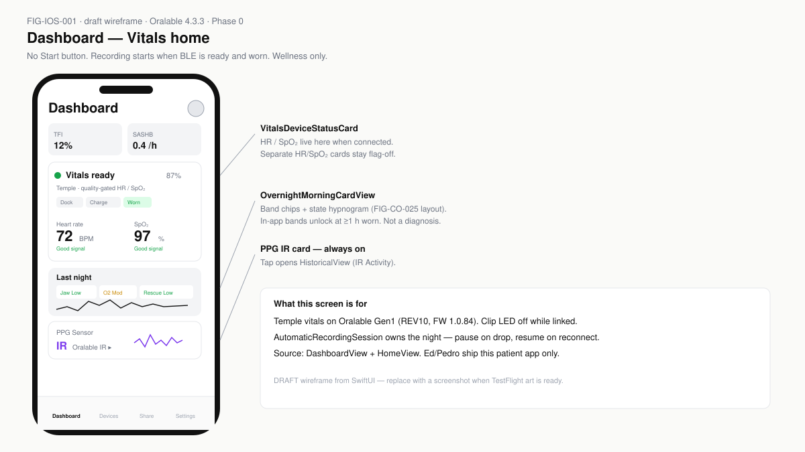

*Figure FIG-IOS-001 — Phase 0 Vitals home (`DashboardView`). Draft wireframe — not a screenshot.*

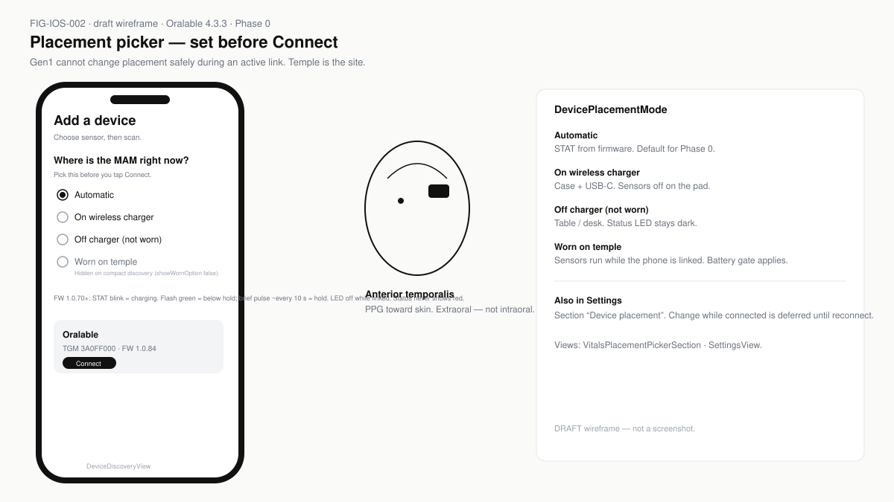

*Figure FIG-IOS-002 — Placement picker (`VitalsPlacementPickerSection`). Draft wireframe.*

---

## 2. How the patient app works — Phase 0

End-to-end working model for **Oralable 4.3.3** + FW **1.0.84**. Wellness wording only — not a medical diagnosis.

### 2.1 Night / day session lifecycle

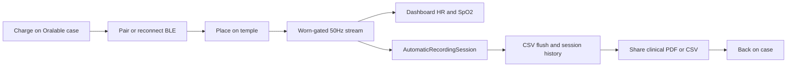

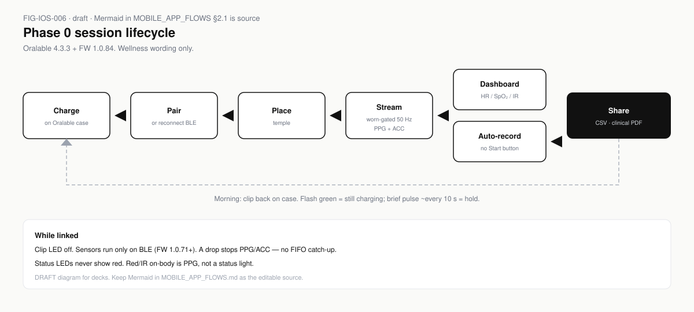

*Figure FIG-IOS-006 — Phase 0 vitals session lifecycle. Mermaid above is the editable source.*

| Step | What the user does | What the app does |
|------|--------------------|-------------------|
| Charge | Clip on Oralable magnetic case (USB-C) | No phone: flash green = still charging (below ~4.20 V); brief green pulse ~every 10 s = hold. While linked: clip LED off; sensors off on the pad. |
| Pair | Open Devices / first-launch discovery | Scan TGM `3A0FF000` → FW gate (≥1.0.63, recommend 1.0.84) → CCC enable |
| Place | Temple (default) | Placement picker: Manual or Automatic (STAT); quality-gated vitals |
| Wear night | Leave app background-capable | Auto-record; pause on disconnect; resume on reconnect |
| Morning | Share / history | Clinical Temporalis PDF + event CSV when samples exist |

### 2.2 Main tab map (what each tab is for)

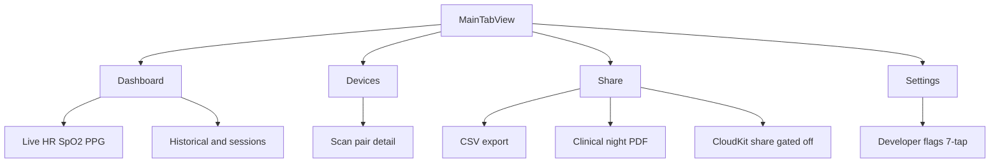

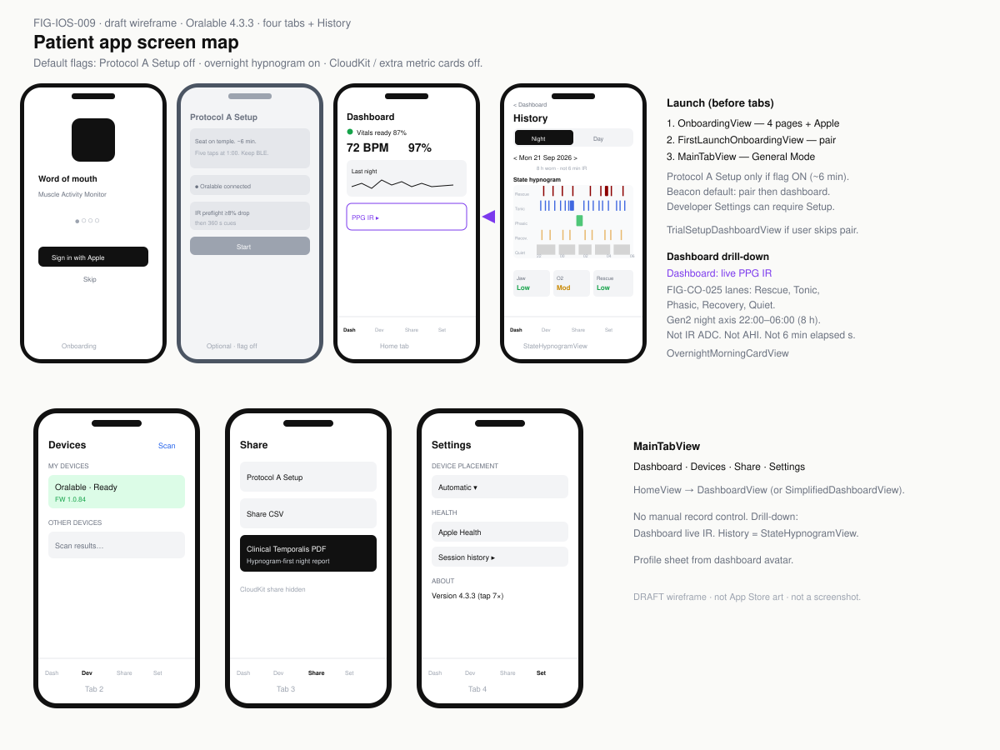

*Figure FIG-IOS-009 — Launch + four tabs + History (`HistoricalView` from Dashboard PPG IR). Draft wireframe.*

### 2.3 Placement and device state (Phase 0)

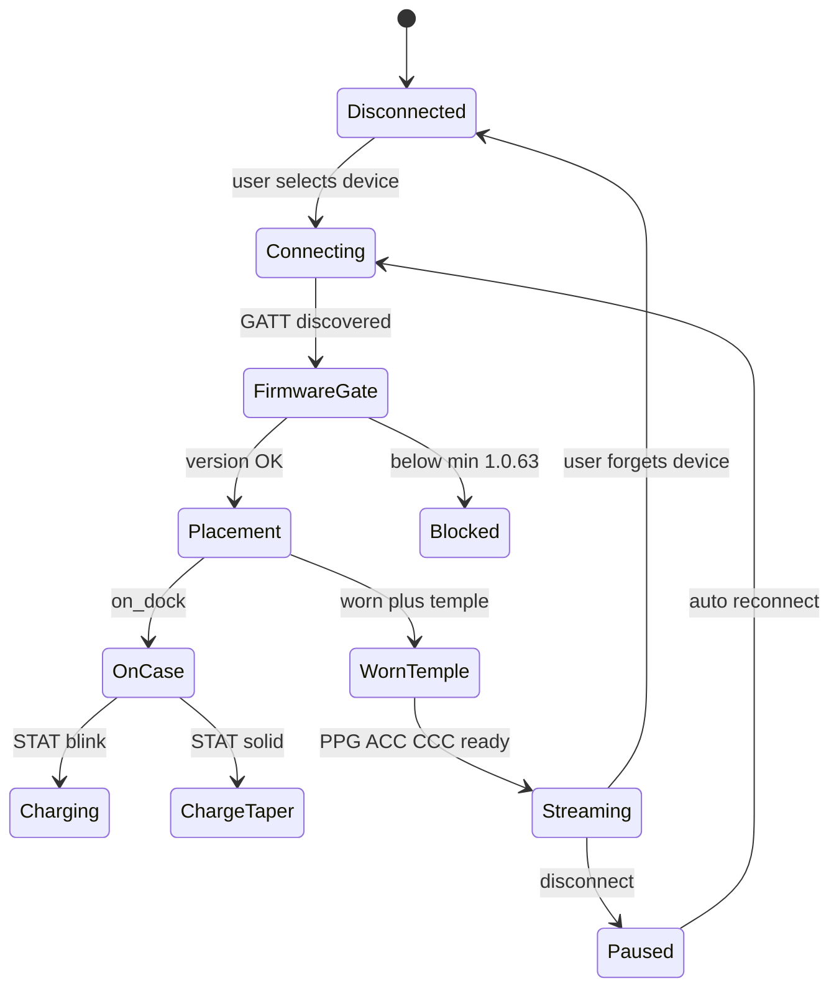

**UI surfaces:** `VitalsDeviceStatusCard` · `DeviceStatusLEDView` · placement picker · worn indicator.

### 2.4 Automatic recording (no Start button)

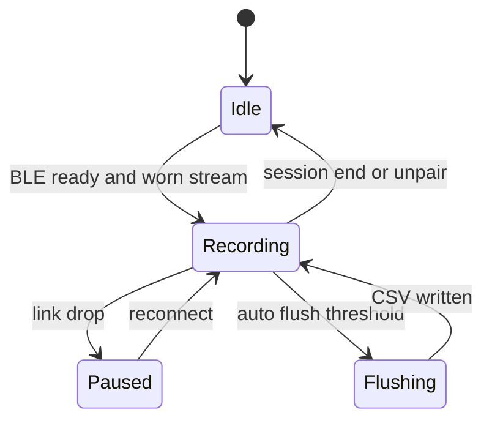

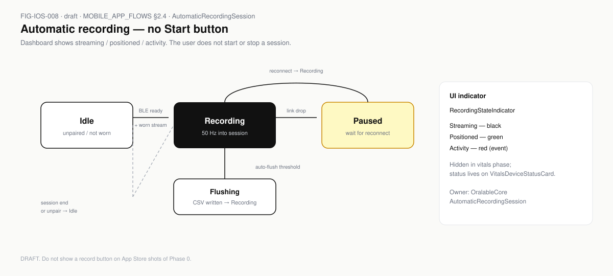

*Figure FIG-IOS-008 — Automatic recording states. No Start button on Phase 0.*

Recording is owned by `AutomaticRecordingSession` (OralableCore). Dashboard shows streaming / positioned / activity via `RecordingStateIndicator` — not a manual start/stop control.

### 2.5 Live data → numbers on screen

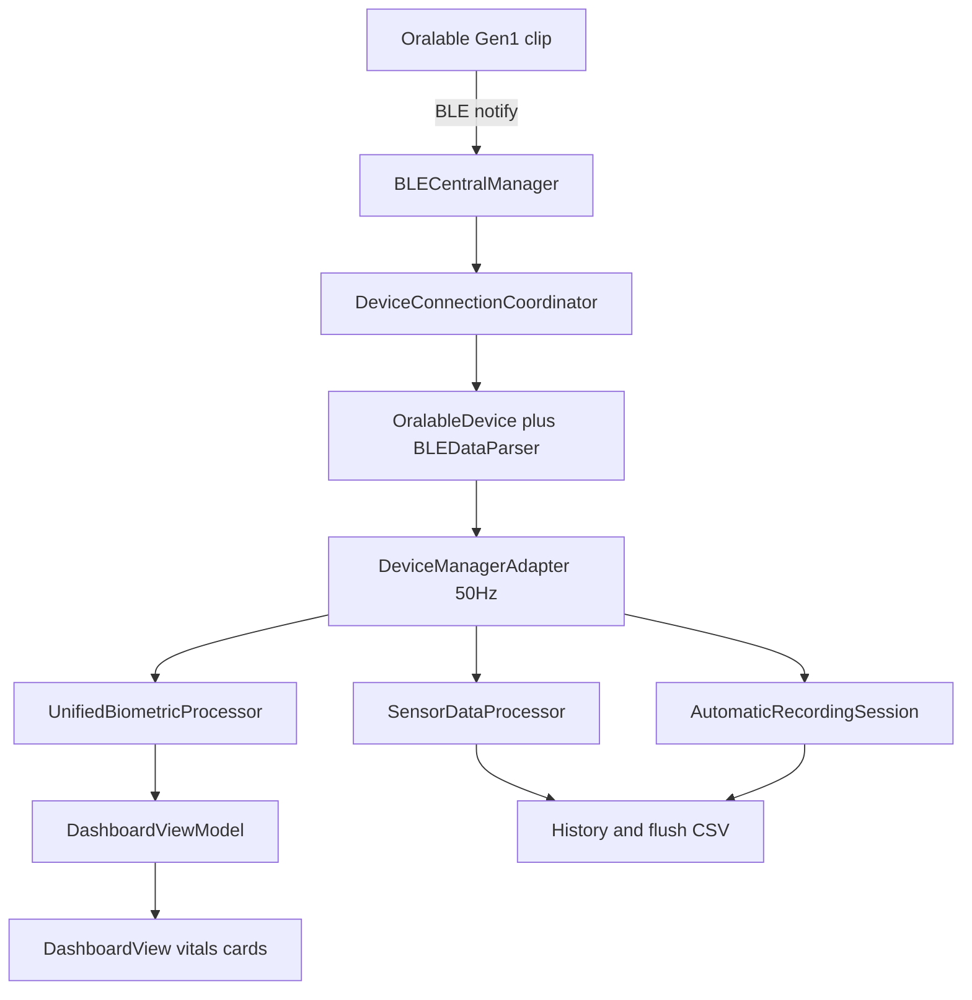

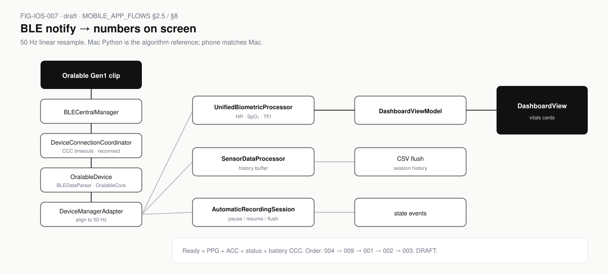

*Figure FIG-IOS-007 — BLE to UI processing stack.*

Detail (CCC order, readiness): [§8 BLE → UI data path](#8-ble--ui-data-path).

---

## 3. Consumer app — launch and navigation

**Controller:** `OralableApp/Views/LaunchCoordinator.swift`

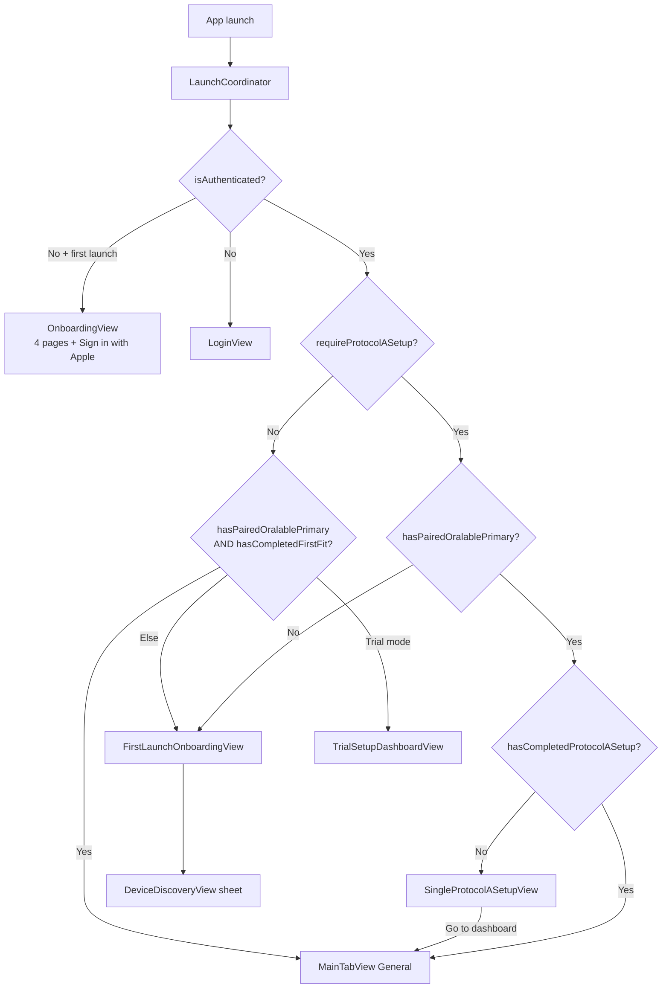

### First-launch setup sequence

**Current (default `requireProtocolASetup = false`):** pair → General Mode (`MainTabView`) for Beacon clinic loaner. Turn **Require Protocol A Setup** ON in Developer Settings for the ~6 min `couple` seat-QC session (Mac cue table + Oralable-only export). Wellness training protocol only — not Dual A, not overnight, not a medical calibration. GATT `worn` is forced for streaming; seat QC is `couple` (unknown / 0 desk / 1 poor / 2 good), matching Mac `run_protocol_a_session.py`. BLE CCC order matches nRF Connect (battery → status → PPG → ACC → temp). Night handoff: Share → **Export night pack** (PDF + flush-rebuilt CSV). Do not send the in-memory ~3 min CSV as the night.

On export complete the pack is **ingested into General Mode**: a completed IR `RecordingSession` (tag `protocol_a_setup`) in session history, plus a Share-tab bookmark for the EDF + sidecar under `Documents/ProtocolASetup/`.

| Step | Screen | Purpose |
|------|--------|---------|
| 1 | `FirstLaunchOnboardingView` | Pair Oralable Gen1 |
| 2 | `DeviceDiscoveryView` | Scan/connect (TGM `3A0FF000`) |
| 3 | `SingleProtocolASetupView` | Couple seat QC (need couple=2, or Allow couple=1) → 360 s cues → export → register session |
| 4 | Dashboard / History / Share | Protocol A Setup listed like an IR session; Share → **Protocol A Setup** section |

**Desk override:** Developer Settings → turn **Require Protocol A Setup** OFF → pair alone unlocks MainTab (legacy Phase 0 vitals path).

**Phase 1+ / legacy (muscle fit — deferred when Protocol A Setup is the gate):**

| Step | Screen | Purpose |
|------|--------|---------|
| 3′ | `TemporalisFitGuideView` | Mirror camera + placement on temporalis peak |
| 4′ | `CalibrationWizardView` | IR-DC baseline / coupling check |
| 5′ | `SetupSuccessView` | Confirm; **only here** → `markFirstFitCompleted()` → `MainTabView` |

**Trial path:** User can skip pairing → `TrialSetupDashboardView` (limited dashboard without full setup).

**Auto-resume:** Legacy `temporalisSleepCalibration` restore skips Protocol A **only** when `requireProtocolASetup` is false.

### Main tabs (`MainTabView.swift`)

| Tab | Root view | Notes |
|-----|-----------|-------|
| Dashboard | `HomeView` → `DashboardView` **or** `SimplifiedDashboardView` | Toggle via Settings → `useSimplifiedDashboard` (`@AppStorage`) |
| Devices | `DevicesView` | BLE scan, paired devices, `DeviceDetailView` |
| Share | `ShareView` | CSV, Protocol A Setup pack (EDF), Protocol B log (when not vitals-only), clinical PDF |
| Settings | `SettingsView` | Health, **Session history** (Protocol A + recordings), support, hidden developer settings (7-tap version) |

Screen map: [FIG-IOS-009](./figures/FIG-IOS-009-tab-screen-map.svg).

### Dashboard drill-down

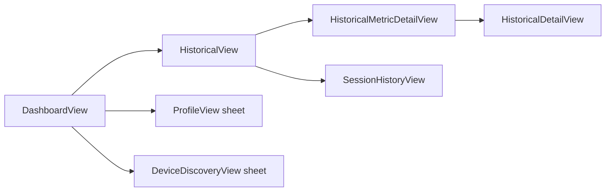

**Recording:** Automatic on BLE connect (`AutomaticRecordingSession`); no manual start/stop on dashboard. State indicator: streaming / positioned / activity (`RecordingStateIndicator`).

---

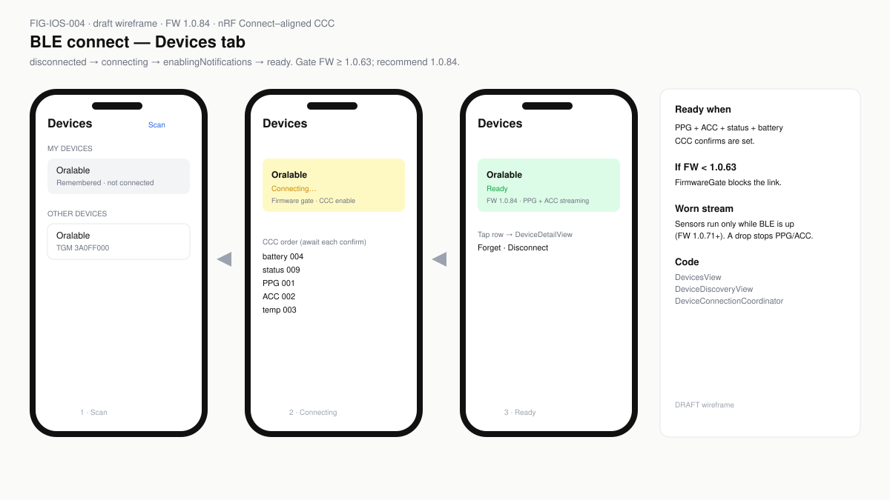

*Figure FIG-IOS-004 — BLE connect: scan → CCC enable → ready. Draft wireframe.*

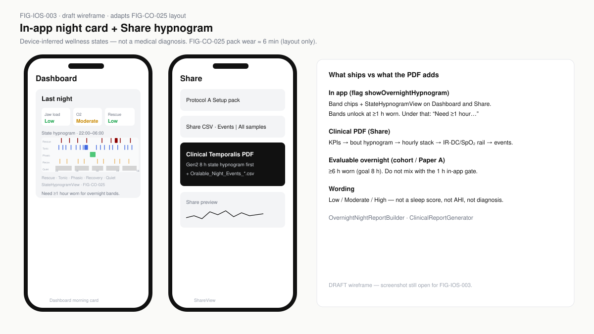

*Figure FIG-IOS-003 — iOS night report / hypnogram (adapts [FIG-CO-025](../../cursor_oralable/docs/figures/FIG-CO-025-state-hypnogram-exemplar.png); `StateHypnogramView`). Draft wireframe.*

## 4. Consumer app — screen inventory

| Screen | File | Status | Notes |
|--------|------|--------|-------|
| Launch coordinator | `LaunchCoordinator.swift` | ✅ Shipped | Auth + pair + Protocol A Setup gate |
| Welcome onboarding | `OnboardingView.swift` | ✅ | 4 pages, Sign in with Apple, skip |
| Login | `LoginView.swift` | ✅ | Returning users |
| First-launch setup | `FirstLaunchOnboardingView.swift` | ✅ | Pair entry |
| Protocol A Setup | `SingleProtocolASetupView.swift` | ✅ | Single-MAM couple seat QC + 360 s cues (default gate ON; Mac parity) |
| Trial dashboard | `TrialSetupDashboardView.swift` | ✅ | Skipped pairing |
| Main tabs | `MainTabView.swift` | ✅ | 4 tabs |
| Dashboard (full) | `DashboardView.swift` | ✅ | PPG IR always; optional cards behind flags |
| Dashboard (simplified) | `SimplifiedDashboardView.swift` | ✅ | Reduced layout |
| Apple Health summary strip | `DashboardView` (`showAppleHealthSummary`) | ✅ | TFI + SASHB cards when clinical metrics on |
| Devices list | `DevicesView.swift` | ✅ | |
| Device discovery | `DeviceDiscoveryView.swift` | ✅ | Scan + pair |
| Device detail | `DeviceDetailView.swift` | ✅ | |
| Share / export | `ShareView.swift` | ✅ | CSV paths; CloudKit share gated |
| Professional share section | `ProfessionalShareView.swift`, share components | ✅ | Behind `showCloudKitShare` |
| Settings | `SettingsView.swift` | ✅ | |
| Subscription | `SubscriptionSettingsView.swift` | ✅ | Behind `showSubscription` |
| Thresholds / events | `ThresholdsSettingsView.swift`, `EventSettingsView.swift` | ✅ | Behind flags |
| Developer settings | `DeveloperSettingsView.swift` | ✅ | Feature flags, demo mode, FW tools |
| Historical overview | `HistoricalView.swift` | ✅ | Charts, date navigation |
| Historical detail | `HistoricalDetailView.swift` | ⚠️ Partial | PDF + HealthKit export stubs |
| Session history | `SessionHistoryView.swift` | ✅ | |
| Temporalis fit guide | `TemporalisFitGuideView.swift` | ✅ | Mirror + calibration flow |
| Calibration | `CalibrationWizardView.swift`, `CalibrationView.swift` | ✅ | |
| Setup success | `SetupSuccessView.swift` | ✅ | Gates main app |
| Profile | `ProfileView.swift` | ✅ | |
| Logs / debug | `LogsView.swift`, `DebugMenuView.swift` | ✅ Dev | |
| Worn status | `WornStatusView.swift` | ✅ | Off-body indicator |
| Subscription tier picker | `SubscriptionTierSelectionView.swift` | ✅ | |

**Component library:** `OralableApp/Components/`, `DesignSystem.swift`, `OralableCore/DesignSystem/`.

---

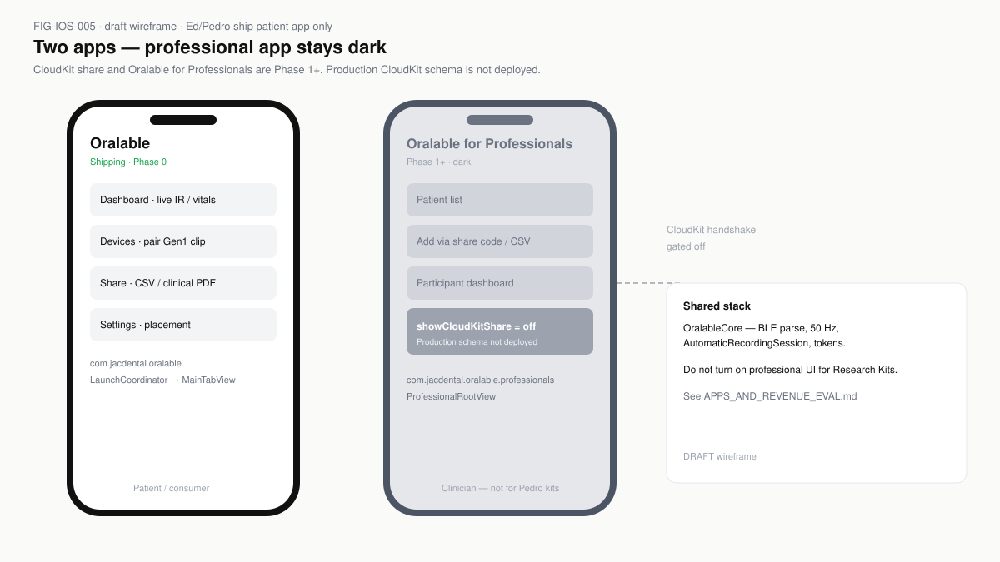

*Figure FIG-IOS-005 — Dentist app dark / deferred (Phase 1+). Ed/Pedro: patient app only.*

## 5. Professional app — navigation

**Controller:** `ProfessionalRootView` in `OralableForProfessionals.swift`

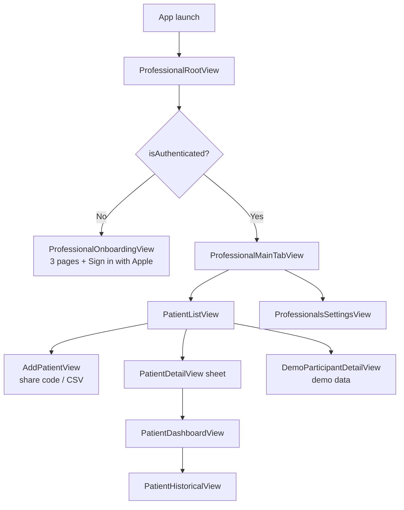

---

## 6. Professional app — screen inventory

| Screen | File | Status | Notes |
|--------|------|--------|-------|
| Professional onboarding | `OralableForProfessionals.swift` | ✅ | 3 pages + Sign in |
| Participant list | `PatientListView.swift` | ✅ | Search, empty state, upgrade banner |
| Add participant | `AddPatientView.swift` | ✅ | 6-digit share code + CSV import |
| Participant detail | `PatientDetailView.swift` | ✅ | Wraps dashboard |
| Participant dashboard | `PatientDashboardView.swift` | ✅ | TFI / session summary |
| Participant historical | `PatientHistoricalView.swift` | ✅ | Multi-session charts |
| Demo participant | `DemoParticipantDetailView.swift` | ✅ | `DemoDataManager` |
| Settings | `ProfessionalsSettingsView.swift` | ✅ | |
| Upgrade prompt | `UpgradePromptView.swift` | ✅ | Starter tier limits |
| Developer settings | `DeveloperSettingsView.swift` | ✅ | |

---

## 7. Patient → dentist data flow

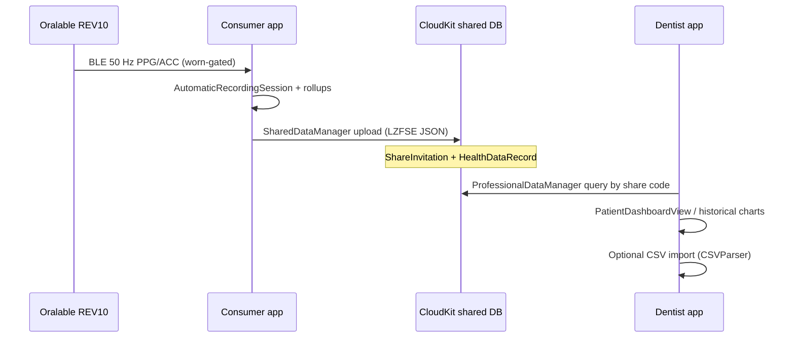

**Handshake export:** `OralableCore` `ProfessionalHandshakeExport` — hourly TFI / SASHB for clinician review.

**Launch blocker:** Production CloudKit schema not deployed — see [CLOUDKIT_PRODUCTION_SETUP.md](../OralableApp/CLOUDKIT_PRODUCTION_SETUP.md).

---

## 8. BLE → UI data path

Technical flow (not screen flow). See also `cursor_oralable/docs/upload/02_IOS_BLE_STREAMING_SUMMARY.txt` and [§2.5](#25-live-data--numbers-on-screen).

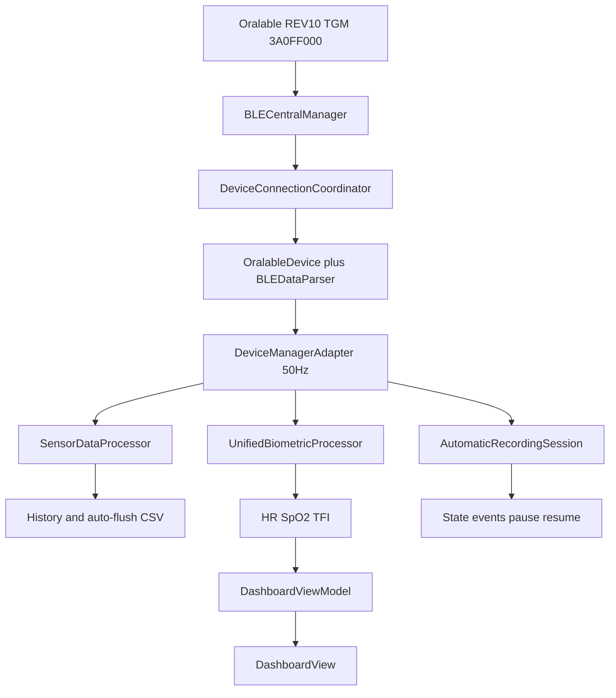

**Connect readiness:**


Ready when PPG + ACC + **status + battery** CCC confirms are set (`OralableDevice.NotificationReadiness.allRequired`).

**CCC order (await each `didUpdateNotificationState`):** battery `004` → status `009` → PPG `001` → ACC `002` → temp `003`. Battery CCC and streaming CCC blocks use **timeouts**; on failure the coordinator calls `cancelPendingContinuations()` so waiters do not hang. Disable/`isNotifying == false` also resumes waiters with error.

---

## 9. Pre-launch UI (feature flags)

`FeatureFlags.swift` — toggles in **Developer Settings** (tap app version 7× in Settings).

| Flag | Default (pre-launch) | UI affected |
|------|----------------------|-------------|
| `showHeartRateCard` | **false** | Dashboard HR card |
| `showSpO2Card` | **false** | Dashboard SpO₂ card |
| `showMovementCard` | **false** | Movement / ACC card |
| `showTemperatureCard` | **false** | Temperature card |
| `showBatteryCard` | **false** | Battery card |
| `showEMGCard` | **false** | EMG card (ANR path) |
| `showSubscription` | **false** | Settings subscription section |
| `showCloudKitShare` | **false** | Share with professional |
| `showDetectionSettings` | **false** | Thresholds / event settings |
| `showPilotStudy` | **false** | Pilot UI |
| `showOvernightHypnogram` | **true** (vitals) / **false** (App Store Minimal) | Dashboard morning card + Share hypnogram preview (FIG-CO-025 adaptation) |
| `requireProtocolASetup` | **false** | Optional ~6 min Protocol A Setup. Beacon default: pair unlocks dashboard. Developer Settings can turn ON for couple seat QC. |
| `showDualProtocolA` | **false** | **Lab/TestFlight only** (not Beacon). Dual Protocol A (~6 min + ANR): EMG preflight → MAM `couple` seat QC → cues. Share pack includes **`session.edf` with ANR EMG**. FW 1.0.71+: abort if Oralable BLE drops. |
| PPG IR card | **always on** | Core dashboard waveform |

**Research EDF+:** Dual A Share writes `TEMPORALIS_RAW_*` + `ANR_EMG_*` + `DUAL_PAIR_*` + `session.edf` (EMG when ANR used). Oralable-only EDF (no EMG): Developer Settings → Export Oralable-only session.edf. Not PSG; not AHI. Mac `align_anr_oralable_concordance.py` remains methods reference.

**App Store screenshots** should reflect **flag-off** consumer UI unless you intentionally launch with flags lifted.

### Firmware diagnostics (Developer Settings, FW ≥ 1.0.37)

Hidden: Settings → About → tap version **7×** → **Developer Settings**.

| Action | BLE | Purpose |
|--------|-----|---------|
| Auto on connect | Notify `3A0FF00A` | Firmware log lines → app log + nRF CSV export |
| **Dump firmware diagnostics** | Write `3A0FF00B` opcode `0x07`, read `3A0FF00C` | Snapshot charging/worn/battery + config state |
| **Apply firmware settings** | Write `3A0FF00B` TLV | LED PA, intervals, stream mask (bench) |
| **Export nRF-style CSV** | — | Full session log for side-by-side with nRF Connect |

iOS `FirmwareGate` minimum **1.0.63** (hard gate). Recommend **1.0.85** until a Gen 2 unit advertises. Gen 2 **2.0.x** uses the same GATT and is accepted when those units exist. Do not raise the gate before that. Automatic dock is **1.0.70+**. Older than **1.0.70** still connect with manual placement.

---

## 10. Done vs remaining

### ✅ Implemented (code-complete)

- Dual-app architecture + OralableCore
- Full launch graph (auth → onboarding → setup → tabs)
- Real-time dashboard + historical charts + session history
- Automatic recording with disconnect pause/resume
- BLE nRF Connect–aligned connect (FW ≥ 1.0.36 gate; awaited CCC; fw-log `00A`–`00C` when FW ≥ 1.0.37)
- **Vitals phase:** `VitalsDeviceStatusCard` + **Device LED mirror** (`DeviceStatusLEDView` / OralableCore `statusLED()`)
- Share/export CSV paths, clinical PDF generator (server-side path in app)
- StoreKit 2 code (6 IAP products)
- Design system + asset colors (both apps)
- UI tests: `OnboardingUITests`, `NavigationTests`, `NRFConnectCompatibilityTests`
- Demo data path for dentist app
- **Draft SVG wireframes** `FIG-IOS-001`…`009` (phone frames + flows; not screenshots)

### ⏳ Launch blockers (infra, not UI code)

| Item | Doc |
|------|-----|
| CloudKit production schema | `CLOUDKIT_PRODUCTION_SETUP.md` |
| App Store Connect IAP live | `APP_STORE_CONNECT_IAP_SETUP.md` |
| Metadata + screenshots + submission | `APP_STORE_METADATA.md`, `DENTIST_APP_STORE_METADATA.md` |

### ✅ Shipped (export + in-app hypnogram)

| Item | Spec reference | Notes |
|------|----------------|-------|
| **Overnight clinical PDF** | [OVERNIGHT_NIGHT_REPORT.md](../../cursor_oralable/docs/OVERNIGHT_NIGHT_REPORT.md) · FTS APP-10 | Share → **Export night pack** — PDF + flush-rebuilt `Oralable_NIGHT_YYYYMMDD.csv` + event CSV. RAM CSV is not the night. Beacon ≥4 h / figure ≥6 h copy. |
| **In-app state hypnogram** | OVERNIGHT · FIG-CO-025 · APP-10 | `StateHypnogramView` + `OvernightMorningCardView` + `OvernightNightReportBuilder`; Share preview + Dashboard; flag `showOvernightHypnogram` |

### 🔲 Product UX not designed or built

| Item | Spec reference | Notes |
|------|----------------|-------|
| **Overnight morning card polish** | OVERNIGHT_NIGHT_REPORT · APP-10 | Core UI shipping; screenshot art for FIG-IOS-003 still open |
| **App Store screenshot designs** | Launch checklist | 7 per app — copy exists, art not in repo |
| PDF export from `HistoricalDetailView` | Launch checklist known issues | Stub at line ~73 |
| HealthKit from HOI / Settings | Apple Health | HR + SpO₂ samples (5 s downsample). Sleep stages not written. |
| Dentist onboarding guide (PDF/web) | Launch checklist post-launch | |
| Android app | Landscape §10 | Native Kotlin MVP, 2026 H2 target |
| In-app firmware OTA | Landscape §12 | Use Nordic Device Manager for now |
| iPad / Watch / widgets | Launch checklist post-launch | |

---

## 11. Roadmap and timeline

Aligns with [PRODUCT_ROADMAP.md](../../cursor_oralable/docs/PRODUCT_ROADMAP.md), [IP_NORTH_STAR.md](../../cursor_oralable/docs/IP_NORTH_STAR.md), [COST_AND_TIMELINE.md](../../cursor_oralable/docs/data_room/COST_AND_TIMELINE.md), [LAUNCH_READINESS_CHECKLIST.md](../OralableApp/LAUNCH_READINESS_CHECKLIST.md), and [ORALABLE_MARKET_LANDSCAPE.md](../../oralable_nrf/docs/ORALABLE_MARKET_LANDSCAPE.md) §12.

| Phase | Target | Hardware | Deliverables |
|-------|--------|----------|--------------|
| **Phase 0 — Vitals** | Now – Sep 2026 | Gen1 BOM REV8 / REV10 / FW **1.0.84** · app **4.3.3** | Temple HR/SpO₂; placement + STAT LED mirror; kits **gated**; patient app only |
| **Eng overnight PDF** | **Shipped 24 Jul 2026** | Same Gen1 | Share clinical PDF + Mac night pack (hypnogram-first) — early eng, not Phase 1+ complete |
| **Phase 1+ — Muscle** | Q4 2026 – Q1 2027 | **Same Gen1** hardware | IR-DC / TFI / SASHB live UX; Protocol B; ≥6 h overnight eval; morning card polish (hypnogram UI already shipping) |
| **Gen2 hardware** | Future, evidence-gated | BOM REV9 / REV11 / ES4L15BA1 / FW 2.0.x candidate | Not a currently supported device. Pin, sensor, TGM BLE/stream, battery/charge, update, and physical-iOS soak evidence remain required; see `GEN2_COMPATIBILITY_GATE.md`. |
| **P4 — Android MVP** | Q3–Q4 2026+ | Gen1 stream | Kotlin BLE + local CSV |
| **P5 — Regulated UI** | H2 2027 – 2028 | Gen2 primary | SaMD-locked labeling, 510(k) monitoring claims |

Canonical calendar: [PRODUCT_ROADMAP.md §3](../../cursor_oralable/docs/PRODUCT_ROADMAP.md#3-timeline-calendar--canonical).

### Unified overnight report (status)

**Canonical direction:** [`OVERNIGHT_NIGHT_REPORT.md`](../../cursor_oralable/docs/OVERNIGHT_NIGHT_REPORT.md)

- **Evaluable overnight:** **≥ 6 hours** worn (goal **8 h**). Under 6 h → Insufficient data (no bands).
- **Scoring:** blood-pressure-style **Low / Moderate / High** on TFI, SASHB/h, rescue/h, tonic min/h — **not** sleep-score-first; cohort percentiles later; personal trends first.
- **Primary graphic:** **state hypnogram** (most useful overnight view). Hourly stack and dual-rail support dentist detail; 3D is appendix.

**Shipped (Share PDF):** `ClinicalReportGenerator` + `OvernightStateClassifier` + `NightReportSampleLoader`
Pages: KPIs → **bout hypnogram (lead)** → hourly stack + SASHB → smoking-gun IR-DC/SpO₂ → event table; plus `Oralable_Night_Events_*.csv`.
Samples from `sensorDataHistory` + memory-flush CSVs + session `dataFilePath`.

**In-app (shipping):** morning card + Share preview with **band chips + state hypnogram** (adapts FIG-CO-025):

```
┌─────────────────────────────────────────┐
│  Night · ≥6h · Jaw load | O2 | Rescue   │  ← Low / Moderate / High chips
├─────────────────────────────────────────┤
│  State hypnogram (primary)              │  ← StateHypnogramView
├─────────────────────────────────────────┤
│  [Share PDF] (hourly / dual-rail in PDF)│
└─────────────────────────────────────────┘
```

Consumer: Dashboard + Share hypnogram; full hourly/dual-rail in Clinical PDF.
Dentist: same bands + hypnogram language later; handshake hourly rollups.

**Feature flag:** `showOvernightHypnogram` — Developer Settings → Overnight Hypnogram.

---

## 12. Source files (navigation)

| Concern | Path |
|---------|------|
| Consumer launch flow | `OralableApp/Views/LaunchCoordinator.swift` |
| Consumer tabs | `OralableApp/Views/MainTabView.swift` |
| First-launch state | `OralableApp/Managers/FirstLaunchManager.swift` |
| Professional root | `OralableForProfessionals/OralableForProfessionals.swift` |
| Feature flags | `OralableApp/Managers/FeatureFlags.swift` |
| CloudKit share | `OralableApp/Managers/SharedDataManager.swift` |
| Pro data ingest | `OralableForProfessionals/Managers/ProfessionalDataManager.swift` |
| Design tokens | `OralableCore/Sources/OralableCore/DesignSystem/` |

---

*Maintainers: update this file when adding a new root navigation path or shipping a major UX phase. Bump version in footer when structure changes.*
